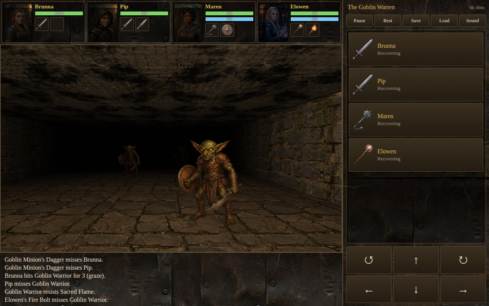

# Cryptlight

A general-purpose, real-time, first-person grid dungeon crawler engine in the tradition of classic
Atari ST games, with a 5E compatible ruleset and an original first-level adventure,
*The Well at Thornwick*. It needs no build step and no runtime dependencies.



```
npm start        # then open http://localhost:8080
npm test         # data, rules, engine, and a bot that plays the whole adventure
npm run test:browser   # real mouse and keyboard input in headless Chrome
```

## Playing

Click things in the view: pick up items, work doors, levers and chests, target monsters. While holding an
item, click the near floor to set it down, or further away to throw it.

| Keys | |
|---|---|
| W S / arrows | Forward, back |
| A D | Sidestep |
| Q E / left right | Turn |
| 1-4 | A character's gear and stats |
| Shift+1-4 | A character's actions |
| Space | Pause (you can still give orders) |
| K / L | Save / load |

Combat runs in real time. Each character has an Action and a Bonus Action that recover after a 6-second round,
which plays in 4 real seconds. Monsters follow the same clock. Your front two characters can reach the
cell ahead; the back two need reach, ranged weapons or spells. Pause whenever you need to think.

## Layout

| Path | What |
|---|---|
| `engine/` | The generic engine. Imports nothing from any ruleset (a test enforces this). See [docs/ENGINE.md](docs/ENGINE.md). |
| `rules/srd5/` | The 5E compatible ruleset. |
| `modules/thornwick/` | The adventure, entirely as data. |
| `data/srd/` | Generated from the SRD by `npm run extract`: 330 monsters, 339 spells, 258 magic items, weapons, armor, gear, classes, conditions and rules text. |
| `assets/raw/`, `assets/game/` | Gemini's output, and the game-ready versions made from it. |
| `tools/` | The SRD extractor, art pipeline, server and browser driver. |

## What's implemented

**All classes, species and backgrounds can be chosen**, at levels 1-2 (level 2 is the current cap).

- **Rules:** D20 Tests, Advantage/Disadvantage, Armor Class, armor training, all weapon properties and masteries, conditions,
  resistances, concentration, death saves, Temporary HP, Opportunity Attacks against the party, XP, Short and Long Rests, darkvision and light, traps, locks.
- **Monsters:** any of the 330 stat blocks can be placed in a module. Attacks, Multiattack, damage, saves, Recharge
  abilities and on-hit conditions are read from their stat blocks.
- **Spells:** 40 cantrips and level 1 spells work (`rules/srd5/spells.js`). The other 299 are in the data as reference.

### Known simplifications

- Spell and skill choices use recommended picks per class; there's no chooser yet. Weapon masteries likewise.
- Monster spellcasting and Bonus Actions aren't used (Vesper fights with her blade, not her spell list), and traits are only
  applied where listed: Undead Fortitude and Pack Tactics.
- Magic items are data only, apart from Potions of Healing and +1 weapons. Equipping most does nothing yet.
- Level 2 adds HP, slots, spells, Action Surge, Reckless Attack, Channel Divinity and Focus (Flurry of Blows), but not every level 2 feature.
- Some species traits aren't mechanical yet, and Dragonborn and Tieflings are fixed to fire. Bardic Inspiration acts as a short Bless. Great Weapon Fighting is averaged as +1.
- Divine Smite is cast before the hit rather than after. Encumbrance isn't enforced. Torches don't burn during rests.
- The party loses as soon as nobody is standing, though the SRD would let a dying character roll on.
- The default party's portraits are tied to class, so a custom elf fighter shows the dwarf fighter's face.

## Art

All images are generated by Google Gemini from the prompts in `tools/art-manifest.mjs`:

```
npm run art:generate -- --force --only rat,cultist   # regenerate some (uses paid API credits)
npm run art:process                                  # key, tile and resize into assets/game
```

## Credits and license

The project is released under the [MIT License](LICENSE), except that material from the SRD, in `data/srd/`
and wherever else it appears in the rules, stays under CC-BY-4.0 as described below. MIT doesn't remove that
attribution requirement.

This work includes material from the System Reference Document 5.2.1 (“SRD 5.2.1”) by Wizards of the Coast LLC,
available at https://www.dndbeyond.com/srd. The SRD 5.2.1 is licensed under the Creative Commons Attribution 4.0
International License, available at https://creativecommons.org/licenses/by/4.0/legalcode.

Only the SRD is used, not the rest of the publisher's site, whose other content isn't openly licensed.
The game shows this notice on its title, creation and end screens. Keep it there if you redistribute the game.
